# Database



The application uses **PostgreSQL** with **Prisma**. The Prisma schema is maintained in [`prisma/schema.prisma`](../prisma/schema.prisma), and database changes are versioned with Prisma migrations.

## Data model

The database is organized around a warehouse, its inventory, reusable operations, and a complete history of changes.

| Table / model | Purpose |
|---|---|
| `app_user` | Stores application users. |
| `warehouse` | Represents an inventory context. |
| `warehouse_membership` | Connects users to warehouses and stores their warehouse-specific role. |
| `item` | Stores inventory items and their quantities. |
| `item_attribute` | Stores customizable attributes for items. |
| `action` | Stores reusable operations for changing inventory. |
| `action_step` | Stores the ordered steps within an action. |
| `change_event` | Groups one logical inventory operation for the timeline. |
| `change_entry` | Records the individual item or field changes within an event. |
| `warehouse_snapshot` | Stores a read-only document of the exact warehouse state, created manually between events. It is never used for restore. |

## Main relationships

- A **user** can belong to many **warehouses** through `warehouse_membership`.
- A **warehouse** owns its **items**, **attributes**, **actions**, **change events**, and **snapshots**.
- An **item** can have multiple customizable **attributes**.
- An **action** contains ordered **action steps** that can modify items or attributes.
- A **change event** can contain multiple **change entries**. It has no link to snapshots.
- A **snapshot** is independent of change events and is created manually by a user.
- A restore operation creates a new change event linked to the historical event it restores.

## Inventory

Items belong to one warehouse and have a decimal quantity with three fractional places. Items can be archived using `archivedAt`, which records when they were archived instead of using a simple boolean flag.

Custom item attributes support these data types:

- `TEXT`
- `NUMBER`
- `BOOLEAN`
- `DATE`

Attribute values are stored as PostgreSQL `JSONB` because their representation depends on the selected data type.

## Actions

Actions are reusable warehouse operations. Their steps can:

- increase a quantity;
- decrease a quantity;
- set a quantity;
- set an attribute.

Steps have a unique `(actionId, position)` pair, so their execution order is deterministic.

## History and restoration

The history model separates the operation from its details:

- `change_event` is the meaningful operation shown in the timeline;
- `change_entry` describes each field-level or item-level change (the diff);
- `warehouse_snapshot` stores a read-only document of the exact warehouse state, created manually by a user between events. It references the warehouse and the creating user (`createdByUserId`, set to `NULL` if the user is deleted).

For example, one action that changes three items produces one `ChangeEvent` and at least three `ChangeEntry` records. Events store only diffs, so they stay small even for large warehouses.

Snapshots are created on demand from a "Create snapshot" option. They are not tied to any event and are only viewed, never restored.

Restoring historical state does not modify or remove the original history. Restore is only possible from a change event (from the Timeline, "restore / go back in time"). It rebuilds the state at that event by replaying change entries, and creates a new event with source `RESTORE` linked to the event being restored.

---

## Technical reference

The following sections document implementation details, constraints, and rules that should be preserved when changing the data model.

### Database conventions

- PostgreSQL is the database provider.
- Prisma is the ORM and migration tool.
- IDs use UUIDs.
- Timestamps use PostgreSQL `timestamptz(6)`.
- Quantities use `decimal(18, 3)`.
- Flexible values use PostgreSQL `JSONB`.
- The generated Prisma Client is written to `src/generated/prisma`.
- The ERD is generated at `docs/database-erd.svg`.

### Enums

`WarehouseRole`:

- `ADMIN`
- `WORKER`

`AttributeDataType`:

- `TEXT`
- `NUMBER`
- `BOOLEAN`
- `DATE`

`ActionOperation`:

- `INCREASE_QUANTITY`
- `DECREASE_QUANTITY`
- `SET_QUANTITY`
- `SET_ATTRIBUTE`

`ChangeSource`:

- `MANUAL`
- `ACTION`
- `AI`
- `RESTORE`

`ChangeType`:

- `CREATE`
- `UPDATE`
- `ARCHIVE`
- `RESTORE`

### Key constraints and indexes

- `warehouse_membership` has a unique `(userId, warehouseId)` pair.
- `action_step` has a unique `(actionId, position)` pair.
- `warehouse_snapshot` has no foreign key to `change_event`.
- Warehouse-scoped queries are supported by indexes on `warehouseId`.
- Timeline queries are supported by the composite index on `change_event(warehouseId, createdAt)`.
- Related records are indexed by their foreign keys, including `itemId`, `actionId`, and `changeEventId`.

### Referential integrity

Foreign keys use deliberate deletion behaviour:

- Deleting a warehouse cascades to warehouse-owned data.
- Deleting a user cascades to their memberships.
- Deleting an action creator sets `createdByUserId` to `NULL` without deleting the action.
- Deleting an item is restricted when an existing action step references it.
- Deleting an item sets the related `change_entry.itemId` to `NULL`, preserving the historical entry.
- Deleting a change event cascades to its entries.
- Deleting the event referenced by `restoredEventId` sets that reference to `NULL`.

Application code must not bypass these constraints.

### Data invariants

1. Every item belongs to exactly one warehouse.
2. Every item attribute belongs to an item and a warehouse context.
3. Every action belongs to one warehouse.
4. Action step positions are unique within an action.
5. A user's membership is unique per warehouse.
6. Change events are warehouse-scoped.
7. A snapshot belongs to exactly one warehouse and is not linked to any change event.
8. AI operations use `ChangeSource.AI`; AI is not stored as a database user.
9. Restoring history creates a new event and never rewrites previous events.
10. Quantity changes preserve decimal precision and application-level domain rules.
11. Change entries must store enough before/after values to replay or reverse the change.

### Application-level validation

Not every business rule is encoded in the Prisma schema. In particular, the valid combination of `itemId`, `attributeId`, `numericValue`, and `attributeValue` depends on the `ActionStep.operation`.

The application validation and domain layers must enforce these cross-field rules. A schema change should not assume that nullable fields are valid for every operation.

### Schema change workflow

Schema changes should be made through Prisma migrations:

```text
Edit prisma/schema.prisma
        ↓
npx prisma migrate dev --name <change>
        ↓
Review the generated migration
        ↓
npx prisma generate
        ↓
Commit the schema and migration
```

Containerized environments apply committed migrations with:

```powershell
npx prisma migrate deploy
```
